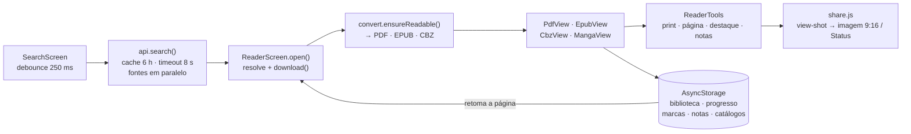

# ReadSearch

App em React Native (Expo) para **buscar e ler HQs, livros e artigos**. Lê PDF e CBZ, converte páginas web em PDF, guarda uma biblioteca local e mostra a memória do aparelho.

## Como rodar

```bash
npm install
npm run dev        # igual ao npm start
npm start          # abre o Expo; escaneie o QR code com o app Expo Go
npm run web        # versão no navegador
npm run proxy      # proxy CORS próprio (web); defina EXPO_PUBLIC_PROXY_URL (veja .env.example)
npm run android    # exige Android SDK/emulador ou aparelho com USB debugging
npm run ios        # exige macOS + Xcode
```

Para testar sem emulador, instale o **Expo Go** no celular (mesma rede Wi-Fi do computador) e escaneie o QR code do `npm start`.

## Stack

<p>
  
  
  
  
  
  
  
  
  
  
  
  
  
  
  
  
  
  
  
  
  
</p>

| Camada | Tecnologia | Uso |
|---|---|---|
| Framework | Expo SDK 54, React Native 0.81, React 19, react-native-web | App Android/iOS + web |
| Linguagem | JavaScript (ES2022) | Todo o app |
| Navegação | React Navigation (bottom-tabs + native-stack) | Abas e tela do leitor |
| UI | `expo-linear-gradient`, `@expo/vector-icons`, `react-native-safe-area-context`, `react-native-screens` | Gradientes, ícones, áreas seguras |
| Persistência | `@react-native-async-storage/async-storage` | Biblioteca, progresso, cache e buscas recentes (localStorage na web) |
| Arquivos | `expo-file-system` (API `legacy`) | Downloads, leitura em pedaços, espaço em disco |
| Leitor de PDF | `react-native-webview` + `pdfjs-dist` 3.11 (embutido, offline) | Renderização preguiçosa de páginas |
| Leitor de HQ | `jszip` | CBZ (e CBR que seja ZIP) |
| Leitor de EPUB | `jszip` + WebView/iframe | Capítulos com imagens e CSS embutidos |
| Web → PDF | `expo-print` | Gerar PDF de HTML e de texto OCR |
| Importar | `expo-document-picker` | PDF, CBZ, CBR e EPUB do aparelho |
| Dispositivo | `expo-device` | RAM total e modelo |
| Proxy CORS | Node.js puro (`server/proxy.js`, sem dependências) | Leitura de HTML na versão web, com proteção contra SSRF |
| Build/Tooling | Metro, `babel-preset-expo`, `scripts/build-pdfjs.js` | Empacota o pdf.js no app (`postinstall`) |

### Fontes de dados (gratuitas, sem chave de API)

| Tipo | Fonte |
|---|---|
| HQ | Internet Archive (`advancedsearch`) |
| Livros | Project Gutenberg (Gutendex) + Internet Archive |
| Mangá | MangaDex (capítulos em pt-br e inglês, hospedados no MangaDex) |
| Livros (repositórios) | GitHub: busca repositórios de e-books e lista apenas os arquivos .pdf de cada um |
| Livros (domínio público) | Wikisource (pt) |
| Artigos | OpenAlex (acesso aberto) + arXiv |

## Estrutura

```
App.js                      Navegação, tema e splash
index.js                    Registro do app
src/
  api.js                    Busca nas fontes, resolução de arquivos do Internet Archive
  cache.js                  Cache de buscas + buscas recentes
  storage.js                Biblioteca (salvar/listar/remover)
  files.js                  Download, web → PDF, leitura base64
  device.js                 Memória/armazenamento do aparelho
  theme.js                  Cores
  components/
    Splash.js               Tela de abertura animada
    BookCard.js, Cover.js   Cartão e capa (com fallback em gradiente)
    Skeleton.js             Placeholder animado de carregamento
    PdfView.js              Leitor de PDF (WebView + pdf.js)
    PdfView.web.js          Leitor de PDF na web (iframe)
    CbzView.js              Leitor de HQ em CBZ
  screens/
    SearchScreen.js         Busca
    LibraryScreen.js        Biblioteca + importar arquivo
    ReaderScreen.js         Orquestra a abertura do conteúdo
    DeviceScreen.js         Memória do aparelho
```

## Fluxo do app

### Fluxo simplificado



### 1. Abertura
`App.js` renderiza a navegação e, por cima, o componente `Splash` ("ReadSearch"). A animação (logo com mola, nome, frase e fade-out) dura cerca de 2 s; ao terminar, `onDone` remove a splash.

### 2. Busca (`SearchScreen` + `api.js`)
1. O usuário digita e escolhe o filtro: **HQ**, **Livros** ou **Artigos**.
2. Com 2 ou mais caracteres, a busca dispara sozinha **250 ms após a última tecla** (debounce). Uma nova digitação cancela a requisição anterior via `AbortController`.
3. `search(query, kind)` consulta primeiro o **cache** (`cache.js`): memória e, depois, AsyncStorage, com validade de 6 h. Se achar, devolve na hora.
4. Sem cache, busca nas fontes **em paralelo**:
   - HQ → Internet Archive filtrado por assunto "comics", pesquisando só em título/autor (mais rápido que texto completo);
   - Livros → Gutenberg + Internet Archive + repositórios do GitHub;
   - Mangá → MangaDex (capa, título e autor; os capítulos são carregados ao abrir);
   - Artigos → OpenAlex com `open_access.is_oa:true`.
5. Cada fonte entrega seus resultados assim que responde (`onResults`), então a grade vai se preenchendo sem esperar a mais lenta. Enquanto carrega, aparecem esqueletos animados.
6. O resultado final é guardado no cache e o termo entra nas **buscas recentes** (máx. 8).
7. Sem texto digitado, a tela mostra buscas recentes e sugestões por categoria.

Cada resultado vira um item padronizado: `{ id, title, author, cover, kind, source, resolve }`. O campo `resolve` diz como obter o arquivo: `ia` (item do Internet Archive), `pdf` (URL direta) ou `web` (página HTML).

### 3. Abrir um item (`ReaderScreen`)
Ao tocar num cartão, a tela do leitor decide o caminho conforme `resolve.type`:

```
ia   → resolveArchive(): consulta /metadata/{id}, escolhe o arquivo .cbz (preferência)
       ou .pdf, e segue como "cbz" ou "pdf"
pdf  → download() para o armazenamento do app (reaproveita se já baixado)
cbz  → download() idem
web  → webToPdf(): converte a página em PDF (ver abaixo)
```

Depois de pronto, o item é salvo na **biblioteca** e exibido no leitor adequado. Erros (sem arquivo legível, falha de rede) aparecem numa tela com botão de voltar.

### 4. Conversão de página web em PDF (`files.js → webToPdf`)
Usado quando o conteúdo é HTML (livros do Gutenberg, artigos sem PDF direto).
1. Baixa o HTML da página (na web, se o navegador bloquear por CORS, tenta um proxy público).
2. Limpa o HTML: remove `<script>`/`<noscript>`, injeta `<base href>` (para imagens e links relativos funcionarem) e um CSS de leitura.
3. **Mobile:** `Print.printToFileAsync` gera o PDF, que é movido para a pasta do app e aberto no leitor de PDF.
4. **Web:** `Print.printAsync` abre o diálogo de impressão do navegador; o usuário escolhe "Salvar como PDF".

### 5. Leitores
- **PDF (mobile):** o arquivo é lido em base64 e injetado num HTML com **pdf.js** dentro de um `WebView`, que desenha cada página em `<canvas>`. No iOS/Android o mesmo caminho serve para arquivos baixados ou importados.
- **PDF (web):** `<iframe>` apontando para o arquivo.
- **CBZ (HQ):** `JSZip` abre o arquivo, lista as imagens (jpg/png/webp/gif) em ordem numérica e as mostra **uma por tela**, com paginação horizontal e contador `n / total`. Cada página só é extraída do zip quando fica visível, para poupar memória.

### 6. Biblioteca (`LibraryScreen` + `storage.js`)
- Toda vez que um item abre, é salvo (ou movido para o topo) no AsyncStorage com título, capa, caminho local e tipo.
- Mostra uma grade com o que você já abriu; reabrir usa o arquivo local, **sem novo download**.
- **Importar PDF / CBZ:** `expo-document-picker` escolhe o arquivo, que é copiado para a pasta do app e aberto no leitor.
- Toque e segure num item para removê-lo.

### 7. Memória do aparelho (`DeviceScreen` + `device.js`)
Mostra armazenamento livre/total (com barra de uso), RAM total e espaço usado pelo ReadSearch. Na web, usa `navigator.storage.estimate()` e `navigator.deviceMemory` (valores aproximados). O botão **Limpar cache e downloads** apaga o cache de buscas e os arquivos baixados.

## Persistência (chaves no AsyncStorage / localStorage)

| Chave | Conteúdo |
|---|---|
| `readgreat:library` | Itens da biblioteca |
| `rs:cache:<tipo>:<termo>` | Resultados de busca em cache (6 h) |
| `rs:recent` | Buscas recentes |

## Melhorias recentes
- **Proxy próprio:** `npm run proxy` sobe `server/proxy.js` (bloqueia IPs internos e protocolos não-http). Configure `EXPO_PUBLIC_PROXY_URL`; sem ele a web usa um proxy público.
- **PDF grande:** o arquivo é enviado ao visor em pedaços de 768 KB, e só as páginas perto da tela são renderizadas (as distantes são liberadas).
- **Offline:** o pdf.js vem embutido no app (`src/pdfjsBundle.js`, gerado no `postinstall`).
- **Progresso:** página/capítulo é salvo na biblioteca e retomado ao reabrir; os cartões mostram uma barra de progresso.
- **EPUB** suportado; **CBR** suportado quando o arquivo é ZIP renomeado.
- **Sem PDF/CBZ no Internet Archive:** o app tenta EPUB, depois o texto OCR (convertido em PDF) e, por fim, o leitor online incorporado.

## Leitura vertical, marcação e compartilhamento
- **Mangá em modo vertical (padrão):** rolagem contínua estilo webtoon, com botão para alternar para páginas horizontais (a escolha fica salva).
- **Marcar:** em EPUB, toque num parágrafo e use *Marcar*; no mangá, toque na página e use *Marcar página*. As marcações ficam salvas por obra.
- **Status do WhatsApp:** em EPUB, *Imagem / Status* gera um cartão 9:16 (4 estilos) com o trecho, título e autor; toque em compartilhar e escolha WhatsApp → Status. No mangá, *Print / Status* compartilha a página.
- **Print da tela:** o botão da câmera, no canto do leitor, captura a tela atual e compartilha. Em PDF/EPUB (WebView) alguns Android capturam em branco; nesses casos use o cartão de imagem.

- **Marca-texto (EPUB):** selecione um trecho (segure sobre a palavra e arraste) e escolha uma de 4 cores para destacar só as letras/palavras. Toque num destaque para removê-lo. Fica salvo por livro.
- **Excluir em lote (Biblioteca):** o botão *Selecionar* liga o modo de seleção; toque nos itens ou use *Selecionar todos* e depois *Excluir* (remove da biblioteca, dos catálogos e apaga os arquivos baixados).

## Ferramentas de leitura (ícone de ferramenta, lado esquerdo)
O botão redondo com ícone de ferramenta, no canto esquerdo do leitor, abre/fecha o painel:

| Ferramenta | PDF | EPUB | HQ (CBZ) | Mangá | Online (IA) |
|---|---|---|---|---|---|
| Tirar print (captura a tela e compartilha) | ✔ | ✔ | ✔ | ✔ | ✔ |
| Marcar página (capítulo, no EPUB) | ✔ | ✔ | ✔ | marcação própria | – |
| Destacar texto com cor | selecionar texto | selecionar texto | arrastar sobre a página | – | – |
| Notas de texto + lista de marcadores | ✔ | ✔ | ✔ | – | – |

- **Destacar texto:** ligue a ferramenta e escolha a cor; ao selecionar um trecho (PDF/EPUB) ele já recebe a cor. Com a ferramenta desligada, a barra de cores aparece depois de selecionar. Na HQ, com o destaque ligado, arraste para pintar uma área e toque nela para apagar.
- **Notas:** *Notas e marcadores* abre um painel para escrever notas (guarda o trecho selecionado como citação), ver as páginas marcadas e pular para elas. Notas e marcadores ficam salvos por obra.
- No PDF aberto na web (visor do navegador) só o print está disponível.

## Conversão automática de formatos
O app só lê **PDF, EPUB e CBZ**; todo o resto é convertido ao abrir (e o resultado fica salvo, sem reconverter).

| Formato encontrado | Vira | Onde converte |
|---|---|---|
| TXT, MD, HTML, FB2, DOCX | EPUB (texto reflowável, com marcação de parágrafos) | No aparelho |
| Texto OCR do Internet Archive, páginas da Wikisource | EPUB | No aparelho |
| Página web (artigos/livros em HTML) | PDF | No aparelho |
| MOBI, AZW, AZW3, LIT, RTF, DOC | EPUB | Servidor (`ebook-convert`, do Calibre) |
| DJVU | PDF | Servidor (`ddjvu`, do djvulibre) |
| CBR com RAR de verdade | CBZ | Servidor (`7z` ou `unrar`, mais `zip`) |

O servidor é o mesmo `npm run proxy` (`POST /convert`). Instale as ferramentas na máquina que o executa e defina `EXPO_PUBLIC_PROXY_URL` no app; use `CONVERT_TOKEN` para exigir senha. Sem o servidor, o app avisa qual ferramenta falta. CBR que na verdade é ZIP abre direto.

