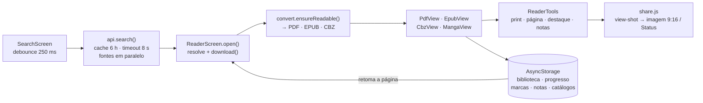

# ReadSearch

App em React Native (Expo) para **buscar e ler HQs, livros e artigos**. Lê PDF e CBZ, converte páginas web em PDF, guarda uma biblioteca local e mostra a memória do aparelho.

## Como rodar

```bash
npm install
npm run dev        # igual ao npm start
npm start          # abre o Expo; escaneie o QR code com o app Expo Go
npm run web        # versão no navegador
npm run proxy      # proxy CORS próprio (web); defina EXPO_PUBLIC_PROXY_URL (veja .env.example)
npm run android    # exige Android SDK/emulador ou aparelho com USB debugging
npm run ios        # exige macOS + Xcode
```

Para testar sem emulador, instale o **Expo Go** no celular (mesma rede Wi-Fi do computador) e escaneie o QR code do `npm start`.

## Stack

<p>
  
  
  
  
  
  
  
  
  
  
  
  
  
  
  
  
  
  
  
  
  
</p>

| Camada | Tecnologia | Uso |
|---|---|---|
| Framework | Expo SDK 54, React Native 0.81, React 19, react-native-web | App Android/iOS + web |
| Linguagem | JavaScript (ES2022) | Todo o app |
| Navegação | React Navigation (bottom-tabs + native-stack) | Abas e tela do leitor |
| UI | `expo-linear-gradient`, `@expo/vector-icons`, `react-native-safe-area-context`, `react-native-screens` | Gradientes, ícones, áreas seguras |
| Persistência | `@react-native-async-storage/async-storage` | Biblioteca, progresso, cache e buscas recentes (localStorage na web) |
| Arquivos | `expo-file-system` (API `legacy`) | Downloads, leitura em pedaços, espaço em disco |
| Leitor de PDF | `react-native-webview` + `pdfjs-dist` 3.11 (embutido, offline) | Renderização preguiçosa de páginas |
| Leitor de HQ | `jszip` | CBZ (e CBR que seja ZIP) |
| Leitor de EPUB | `jszip` + WebView/iframe | Capítulos com imagens e CSS embutidos |
| Web → PDF | `expo-print` | Gerar PDF de HTML e de texto OCR |
| Importar | `expo-document-picker` | PDF, CBZ, CBR e EPUB do aparelho |
| Dispositivo | `expo-device` | RAM total e modelo |
| Proxy CORS | Node.js puro (`server/proxy.js`, sem dependências) | Leitura de HTML na versão web, com proteção contra SSRF |
| Build/Tooling | Metro, `babel-preset-expo`, `scripts/build-pdfjs.js` | Empacota o pdf.js no app (`postinstall`) |

### Fontes de dados (gratuitas, sem chave de API)

| Tipo | Fonte |
|---|---|
| HQ | Internet Archive (`advancedsearch`) |
| Livros | Project Gutenberg (Gutendex) + Internet Archive |
| Mangá | MangaDex (capítulos em pt-br e inglês, hospedados no MangaDex) |
| Livros (repositórios) | GitHub: busca repositórios de e-books e lista apenas os arquivos .pdf de cada um |
| Livros (domínio público) | Wikisource (pt) |
| Artigos | OpenAlex (acesso aberto) + arXiv |

## Estrutura

```
App.js                      Navegação, tema e splash
index.js                    Registro do app
src/
  api.js                    Busca nas fontes, resolução de arquivos do Internet Archive
  cache.js                  Cache de buscas + buscas recentes
  storage.js                Biblioteca (salvar/listar/remover)
  files.js                  Download, web → PDF, leitura base64
  device.js                 Memória/armazenamento do aparelho
  theme.js                  Cores
  components/
    Splash.js               Tela de abertura animada
    BookCard.js, Cover.js   Cartão e capa (com fallback em gradiente)
    Skeleton.js             Placeholder animado de carregamento
    PdfView.js              Leitor de PDF (WebView + pdf.js)
    PdfView.web.js          Leitor de PDF na web (iframe)
    CbzView.js              Leitor de HQ em CBZ
  screens/
    SearchScreen.js         Busca
    LibraryScreen.js        Biblioteca + importar arquivo
    ReaderScreen.js         Orquestra a abertura do conteúdo
    DeviceScreen.js         Memória do aparelho
```

## Fluxo do app


